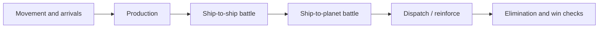

# Space Strategy Game: Rules and Gameplay Specification

## Simple, competitive, fast-paced space RTS with depth

**Version:** 2.4
**Scope:** Game concept, rules and the game loop. The lobby and UI are described in `game-ui.md`. Technical decisions are described in `game-design.md`.

**Parameters and rules:** Every parameter is configurable (see Section 3). The rules in this document are hardcoded and are not configurable.

## 1. Game overview

Players compete in a three-dimensional space full of planets. Each player starts on one planet and builds directed links from the planets they own to other planets. Owned planets produce spaceships. Ships travel along the links one hop at a time. On arrival a ship fights, captures a planet, reinforces a planet, or moves on.

A match ends when one player controls enough planets (domination), when every player is eliminated, or when the timer runs out.

Main loop:

1. Each player claims a starting planet.
2. Players create links from planets they own.
3. Owned planets produce ships.
4. Ships travel along links and are sent onward by each planet they reach. A planet without outgoing links keeps its ships as reinforcement.
5. Ships fight on planets. Planets are captured, lost or reinforced.
6. The match ends by domination, by elimination of all players, or by timer.

## 2. Definitions

| Term                         | Meaning                                                                                                                                               |
| ---------------------------- | ----------------------------------------------------------------------------------------------------------------------------------------------------- |
| **Planet**                   | A point in space with an owner, current points, max points and links.                                                                                 |
| **Player-owned**             | Owned by a player, with at least 1 point.                                                                                                             |
| **Rogue**                    | Unowned, with at least 1 point. A rogue planet does not produce ships and does not regain points.                                                     |
| **Neutral**                  | Unowned, with 0 points. The next ship to arrive captures it. A neutral planet does not produce ships.                                                 |
| **Link**                     | A directed connection `A → B`. Ships can travel from A to B only. Two planets of the same owner can be linked in one direction at a time (Section 8). |
| **Active link**              | A link that has not been removed.                                                                                                                     |
| **Link length**              | The straight-line distance between the centres of the two planets.                                                                                    |
| **Outgoing / incoming link** | `A → B` is outgoing for A and incoming for B. Only outgoing links are used for routing.                                                               |
| **Hop**                      | One ship journey along one link. A longer trip is a series of hops.                                                                                   |
| **Fleet**                    | All ships of one player that are on one planet (arrived, waiting, or just produced).                                                                  |
| **Tick**                     | One step of the game loop (see Section 5).                                                                                                            |
| **Link owner**               | The owner of the link's source planet.                                                                                                                |
| **Ship ID**                  | A number that identifies a ship. Unique within a match, never reused, and increasing with the order in which ships are created.                       |

Planet colours: the owner sees their own planets with a green glow and enemy planets with a red glow. Rogue and neutral planets use the same neutral colour. Spectators see the same colours.

## 3. Parameters

All values can be changed in the config. Defaults are shown.

| Parameter                             |      Default | Meaning                                                                                                    |
| ------------------------------------- | -----------: | ---------------------------------------------------------------------------------------------------------- |
| `maxPlayers`                          |           20 | Maximum number of players in a match.                                                                      |
| `matchDurationSeconds`                |          300 | Match length.                                                                                              |
| `startCountdownSeconds`               |            5 | Wait between the start of the match and tick 1. Players use it to load and look at the map.                |
| `dominationPercent`                   |           30 | Share of planets that wins the match.                                                                      |
| `planetDistribution`                  | `[10,10,10]` | Grid: planets per axis `[x,y,z]`. Random: a single integer (planet count). `null` is not accepted.         |
| `minPlanetDistance`                   |          200 | Minimum distance between two planets (units).                                                              |
| `minReachablePlanets`                 |            0 | Minimum number of planets within `maxHopDistance` of every planet.                                         |
| `mapScale`                            |            1 | Multiplier for the map size. Must be 1 or more. Applied on top of the base size in both modes (Section 4). |
| `maxHopDistance`                      |          400 | Maximum link length and maximum length of one hop (units).                                                 |
| `initialShipSpeed`                    |          200 | Ship speed on the first hop (units per second).                                                            |
| `speedDecayPercent`                   |           10 | Speed lost after each completed hop, as a percentage of the initial speed.                                 |
| `hopDelayTicks`                       |            0 | Ticks a ship waits at a planet between arriving and departing.                                             |
| `tickLengthMs`                        |          100 | Length of one tick.                                                                                        |
| `productionIntervalTicks`             |           10 | Ticks between production rounds (10 ticks of 100 ms = 1 second).                                           |
| `shipsPerProduction`                  |            1 | Ships produced by each owned planet per production round.                                                  |
| `planetPointsMin` / `planetPointsMax` |       1 / 50 | Range of random starting points of a planet.                                                               |
| `attackDamagePerShip`                 |            1 | Points a surviving attacking ship removes from a planet.                                                   |
| `reinforcementPerShip`                |            1 | Points a surviving owner ship adds to its planet.                                                          |
| `capturePoints`                       |            1 | Points a planet has right after it is captured.                                                            |
| `seed`                                |       random | Seed for the world generator and for the random choices of AI players.                                     |
| `unitToPixel`                         |           10 | UI only. 1 unit = 10 pixels.                                                                               |

### 3.1 Parameter validation

A config that breaks any of these constraints is rejected:

1. `maxPlayers` ≥ 1.
2. `matchDurationSeconds` > 0.
3. `dominationPercent` > 0 and ≤ 100.
4. `planetDistribution`: grid values are integers ≥ 1; random value is an integer ≥ 1.
5. `minPlanetDistance` > 0 and `minPlanetDistance` ≤ `maxHopDistance` (otherwise no link is possible).
6. `minReachablePlanets` is an integer ≥ 0.
7. `mapScale` ≥ 1.
8. `initialShipSpeed` > 0.
9. `speedDecayPercent` ≥ 0. A value of 0 means ships never lose speed and can hop without limit.
10. `hopDelayTicks` is an integer ≥ 0.
11. `tickLengthMs` is an integer > 0.
12. `productionIntervalTicks` is an integer ≥ 1.
13. `shipsPerProduction` is an integer ≥ 1.
14. `planetPointsMin` ≥ 1 and `planetPointsMin` ≤ `planetPointsMax`.
15. `attackDamagePerShip`, `reinforcementPerShip` and `capturePoints` are integers ≥ 1.
16. `startCountdownSeconds` ≥ 0.

## 4. World and generator

1. The world is a cube. Its side is a base size multiplied by `mapScale`.
   - Grid: base size = largest axis count × `minPlanetDistance`.
   - Random: base size = the cube root of the planet count, rounded up, × `minPlanetDistance` × 1.25. The factor 1.25 leaves room for random placement, which cannot fill a cube as densely as a grid.
2. **Grid mode:** `planetDistribution` is `[x,y,z]`. Planets are spread evenly over the cube with the given counts per axis. The spacing on an axis is `side / n`, where `n` is the count on that axis. Each planet sits at the centre of its cell, so the margin to the edge of the cube is half the spacing on every side.
3. **Random mode:** `planetDistribution` is one integer. Planets are placed one by one at random positions in the cube, using `seed`. A position closer than `minPlanetDistance` to an already placed planet is rejected and a new position is drawn. Placement stops when the requested number of planets is placed, or when the generator gives up after a fixed number of attempts, so the final planet count can be lower than requested. The base size factor of 1.25 (rule 1) makes the requested count fit in the tested case of 1000 planets. For other counts it is not guaranteed, and a larger `mapScale` leaves more room.
4. No two planets may be closer than `minPlanetDistance`.
5. Every planet must have at least `minReachablePlanets` other planets within `maxHopDistance`.
6. After placement, the generator runs two more steps. The final planet count can be lower than the requested count.
   - Rule 5: every planet that has too few neighbours is removed, and this repeats until no planet breaks the rule.
   - Connected map: two planets are connected when the distance between them is at most `maxHopDistance`. Planets that can reach each other through a chain of connected planets form a group. Only the largest group is kept and all other planets are removed. If two groups have the same size, the group that contains the planet placed first is kept.
     Rule 4 holds by construction: grid spacing is at least `minPlanetDistance`, and random mode rejects close positions. Planet IDs are assigned after these steps, so they have no gaps.
7. The final planet count is used for the domination check.
8. Every planet starts as **rogue** with random integer points from `planetPointsMin` to `planetPointsMax`. Its **max points** equal these starting points and never change.
9. Start of the match. When the host starts the match, the world is generated, the lobby is frozen, and every AI player claims a different random rogue planet, chosen with `seed`. The match then waits `startCountdownSeconds` and tick 1 begins. Human players claim their starting planet during the match (Section 10.4).

## 5. Game loop

The game runs in ticks of `tickLengthMs`. Ticks are numbered from 1. Tick `n` covers match time up to `n × tickLengthMs`.

**Player actions.** Planet claims, link creation and link removal requested during a tick are applied at the start of the next tick, before movement, in the order the server received them, regardless of which player sent them. Each action is checked when it is applied: links against Section 8, claims against Section 10.4. An action that is no longer valid at that moment is dropped. For example, the player no longer owns the source planet, or an earlier action in the same tick already removed the link. When two actions conflict, the one received first is applied and the later one is checked against the new state.

Each tick runs these steps in order:

1. **Movement and arrivals.** Ships move in straight lines. Ships whose arrival time has been reached arrive at their destination planet and join that planet's fleet for their player.
2. **Production.** On every production round (every `productionIntervalTicks`), each player-owned planet produces `shipsPerProduction` ships for its owner, whether or not it has outgoing links. Produced ships join the owner's fleet on that planet.
3. **Ship-to-ship battle.** Fleets of different players on the same planet fight (Section 7.1).
4. **Ship-to-planet battle.** A surviving fleet that does not own the planet attacks it (Section 7.2).
5. **Dispatch / reinforce.** Surviving fleets of the planet's owner are sent onward, or reinforce the planet (Section 7.3).
6. **Elimination and win checks.** See Section 9.

Ships pass through each other in open space. Fights happen only on planets.

## 6. Production, routing and ship speed

### 6.1 Production

1. Production runs on a global schedule: on every tick whose number is a multiple of `productionIntervalTicks`. The first production round is on tick `productionIntervalTicks`. A planet captured between rounds waits for the next production round.
2. Every player-owned planet produces, with or without outgoing links. Rogue and neutral planets produce nothing.
3. New ships belong to the planet's owner, start with `initialShipSpeed`, and join that tick's battles.
4. Produced ships that survive the battles are dispatched if the planet has active outgoing links. If it has none, they reinforce the planet (Section 7.3).
5. The production limit applies only to new ships. Arriving ships that continue are not limited.

### 6.2 Round-robin routing

1. Each planet keeps an ordered list of its active outgoing links. A new link is added to the end of the list. A removed link is taken out of the list.
2. Each planet has one **cursor**: the index of the last used outgoing link. Before the first departure the cursor is −1.
3. The same cursor is used for newly produced ships and for arriving ships that continue.
4. For each departing ship the target index is `cursor + 1`. If this index is equal to or greater than the list length, the target index is 0. The ship departs on the link at the target index and the cursor becomes the target index.
5. When a link is removed and its index is lower than or equal to the cursor, the cursor is reduced by 1.
6. When the planet's owner changes, the cursor is reset to −1.
7. If the list is empty, the dispatch logic is skipped and no ship departs (Section 7.3).
8. Ships leave a planet in fleet order (Section 7.4).

**Example.** Links: `A → D`, `B → D`, `D → E`, `D → F`. D's outgoing list is `[E, F]` and the last ship went to E (cursor 0). In one tick D produces 1 ship and 2 friendly ships arrive and continue (with `hopDelayTicks` 0). The three ships depart in order to `F` (index 1), `E` (index 2 → 0), `F` (index 1). The incoming links from A and B do not affect routing.

### 6.3 Hop delay

1. A ship that arrives at a planet where it will continue departs `hopDelayTicks` ticks later. With the default of 0 it departs in the same tick. Newly produced ships are not delayed and are handled in the tick they are produced.
2. While waiting, a ship belongs to its player's fleet on that planet and takes part in battles.
3. When the delay ends, the ship is handled by Section 7.3: it departs if the planet has active outgoing links, or it reinforces the planet if it has none. The destination is chosen at departure, using the cursor at that moment.

### 6.4 Speed and hop time

1. A ship starts with `initialShipSpeed`.
2. After each completed hop, the ship loses `speedDecayPercent` of the initial speed. This is a fixed amount (20 units per second with the defaults), not a percentage of the current speed.
3. Time is simulated. Tick `n` ends at match time `n × tickLengthMs`. A ship that departs in tick `n` has departure time `n × tickLengthMs`. Its arrival time is the departure time plus link length ÷ current speed. It arrives in the first tick `m` whose end time `m × tickLengthMs` is at or after the arrival time. A ship never arrives in the tick it departed.
4. A ship whose speed is 0 or less cannot start another hop.
5. There is no separate hop limit. With the defaults, the speed decay allows 10 hops.
6. A ship with no speed left still fights when it arrives. If it survives in the owner's fleet, it reinforces the planet when the planet has no active outgoing links, and is removed when the planet has active outgoing links.

## 7. Combat

### 7.1 Ship-to-ship battle

Applies when ships of two or more players are on the same planet in the same tick. This includes the planet's owner. A planet with a fleet of only one player has no ship-to-ship battle.

1. Ships of the same player on the planet form one fleet.
2. The largest fleet loses ships equal to the size of the second-largest fleet.
3. All other fleets are destroyed.
4. If the two largest fleets are the same size, every fleet is destroyed.

**Example.** A has 10 ships, B has 11 and C has 16. C loses 11 and 5 ships of C remain. A and B are destroyed.

**Example.** Two ships from different players arrive at a neutral planet in the same tick. They destroy each other and the planet stays neutral.

### 7.2 Ship-to-planet battle

Applies to a surviving fleet that does not own the planet (the planet is rogue, neutral or owned by someone else).

1. Each ship removes `attackDamagePerShip` points from the planet. Ships used up this way are removed.
2. If the planet still has points, it keeps its owner and the fleet is gone.
3. If the planet reaches 0 points, it becomes **neutral**: its owner is cleared and every link owned by the old owner that touches this planet is removed (Section 8.7).
4. If ships are left over, one of them **captures** the planet. The planet gets `capturePoints` points (not above max points) and the fleet's owner becomes the planet's owner.
5. Any further left-over ships reinforce the planet by `reinforcementPerShip` each, up to max points. Ships beyond max points are destroyed and have no effect on the planet.
6. A neutral planet has no points to remove, so the first ship captures it and the rest reinforce it.
7. If no ships are left over, the planet stays neutral until a later ship arrives.

**Example.** A fleet of 5 hits a rogue planet with 2 points. Two ships bring it to 0. One of the remaining 3 ships captures it (1 point) and the other 2 reinforce it (3 points, limited by max points).

### 7.3 Owner's fleet: dispatch or reinforce

A surviving fleet that owns the planet (arrived, waiting ships whose delay has ended, and produced ships):

1. If the planet has active outgoing links, its ships are sent out by round-robin (Section 6.2), after any hop delay. A ship with no speed left is removed instead (Section 6.4).
2. If the planet has no active outgoing links, each ship adds `reinforcementPerShip` points, up to max points. This includes ships with no speed left. Ships beyond max points are destroyed and have no effect on the planet.

### 7.4 Fleet order

A fleet is an ordered list. Ships are added to the end when they arrive, in order of arrival time. Ships that arrive at exactly the same time are added in order of ship ID. Produced ships are added after the arrivals of the same tick. A ship waiting for its hop delay keeps its place. Ships lost in battle are taken from the front, including ships that are waiting. A departing ship is the first ship in the fleet whose hop delay has ended. Ships that are still waiting are skipped.

### 7.5 Planet points

Planet points never go below 0 or above max points. Max points never change, including after the planet is weakened, made neutral or captured.

## 8. Links and ownership

1. A player can create a link only from a planet they own.
2. A link can go to any other planet (owned, enemy, rogue or neutral), if its length is at most `maxHopDistance`.
3. Links are unique: `A → B` can exist only once. There is no limit on the number of outgoing links per planet other than the planets within `maxHopDistance`.
4. Creating `A → B` does not create `B → A`. If A and B have the same owner, `A → B` exists and `B → A` is created, `A → B` is removed and `B → A` takes its place. If A and B have different owners, both links can exist at the same time.
5. Only the owner of the source planet can remove its outgoing link.
6. Removing a link does not stop ships already travelling on it. They finish that hop.
7. When a player-owned planet becomes neutral, only the links owned by the old owner are removed: all its outgoing links, and its incoming links that start on the old owner's planets. Incoming links from other players stay. A rogue planet that becomes neutral has no old owner, so no link is removed. Ships already travelling finish their hop.
8. A captured planet always passes through neutral (Section 7.2), so the same rule applies. Incoming links of the capturing player stay, so the attacker keeps its route to the planet.
9. A ship arriving at a planet is judged by the planet's state at the moment of arrival, not by its state when the hop began. A planet that has changed owner does not route the ship. The ship fights, captures or reinforces according to Section 7.

## 9. Winning and elimination

Checks run at the end of every tick, in this order.

### 9.1 Elimination

A player who has not yet claimed a starting planet cannot be eliminated. After the claim, a player is eliminated for good, and becomes a spectator, only when they own 0 planets and have 0 ships. Ships include ships in flight and ships waiting for their next hop. A player with no planets but with ships left is still in the match. A ship of theirs that captures a neutral planet gives them a planet again.

If every player is eliminated, the match ends immediately as a draw.

### 9.2 Domination

A player who owns at least the domination threshold wins immediately. The threshold is `dominationPercent` of the final planet count, rounded down, with a minimum of 2 planets. Example: 30% of 997 planets is 299.1, so 299 planets are needed. 30% of 5 planets is 1.5, so 2 planets are needed. If the map has fewer than 2 planets, the match can end only by timer or elimination.

### 9.3 Timer

The match ends at the end of the first tick after `matchDurationSeconds` has passed: the first tick `n` with `n × tickLengthMs` > `matchDurationSeconds × 1000`. The player with the most planets wins. With the defaults the last tick is 3001.

### 9.4 Tie-break

If two or more players are level on the same check (including two players reaching domination in the same tick), the winner is decided in this order:

1. Most planets.
2. Highest total current planet points.
3. Highest total max planet points of their planets.
4. Most ships (ships in flight plus ships waiting for their next hop).

If all four are equal, the match is a draw.

### 9.5 No early end

The match does not end when only one player remains. That player keeps playing until domination or the timer. A match with a single player is allowed.

## 10. Players and connections

1. The host starts the match. No new player can join after it has started. A player who is already in the match can reconnect. There is no minimum number of players.
2. Players cannot create or send ships by hand. Production, routing, movement, battles, captures and reinforcements are automatic.
3. Players can select and inspect any planet or ship. All information is visible to all players.
4. Each human player can claim one starting planet, once, at any time during the match. Finding a good planet quickly is part of the game.
   - The planet must be rogue (unowned, at least 1 point). Its number of points does not matter.
   - The planet becomes owned by the player and keeps its current points and its max points.
   - A claim of a planet that is no longer rogue, or a second claim by the same player, is dropped.
   - The match timer is not delayed for players who claim later.
   - A player who never claims stays in the match with 0 planets until the match ends.
5. Players can create links and remove links (Section 8).
6. The match cannot be paused, by the host or by any player.
7. If a player disconnects, their planets keep running. The player can reconnect and regain control.

## 11. Open items

None. The generator algorithm, including the case where removals leave fewer planets than players, and the technical details of the game loop are defined in `game-design.md`.
